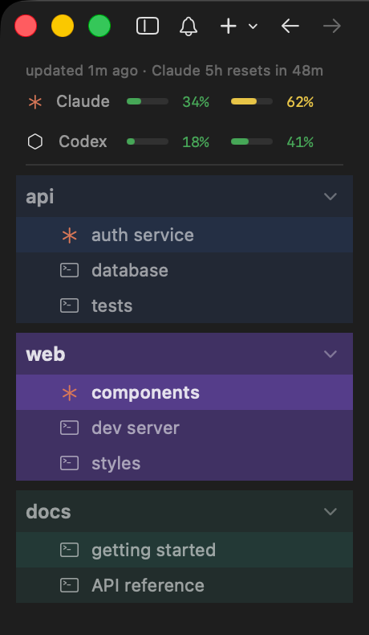

# workspaces-tree — a cmux sidebar

A custom left sidebar for [cmux](https://cmux.com) that shows every workspace
together with the tabs running inside it, tinted in the workspace's color, with
an optional Claude / Codex usage-limits panel on top.



*Usage figures shown are demo values.*

- **Workspaces → tabs tree.** Each tab shows what runs in it: an orange
  asterisk for Claude, a hexagon for Codex (Gemini and OpenCode too), or a
  terminal icon.
- **Drag & drop.** Drag a workspace header to reorder workspaces, or drag a tab
  to reorder it or move it into another workspace.
- **Color ladder.** Every state is a step of the workspace's own color, in
  rising brightness: inactive background → hover in an inactive workspace →
  active background → active tab → hover in the active workspace.
- **Inline rename.** Triple-click a workspace or a tab name (or right-click →
  Rename).
- **Colors.** Right-click a workspace → Color… opens a palette of 24 colors.
- **Collapse / expand** a workspace's tabs with its chevron.
- **New workspace.** Double-click the blank space under the list to create
  `workspace N`, added at the end.
- **Close on hover.** A ✕ appears on the left of a tab (away from the edge, to
  avoid misclicks) and on a workspace header.
- **Waiting agents.** An orange dot marks a tab whose agent waits for your
  input; a blue dot marks an unread notification.
- **Usage limits** (optional): Claude and Codex 5-hour / 7-day usage with reset
  times.

## Install

Requires cmux with **Custom Sidebars** enabled (Settings → Custom Sidebars).

```sh
curl -fsSL https://github.com/Disaldr/cmux-workspaces-sidebar/releases/latest/download/install.sh | sh
```

Then right-click the sidebar button in cmux and choose **workspaces-tree**.
Running the command from a cmux terminal selects it for you.

### With the usage-limits panel

```sh
curl -fsSL https://github.com/Disaldr/cmux-workspaces-sidebar/releases/latest/download/install.sh | sh -s -- --with-limits
```

Run this one **from a cmux terminal**. It needs `node`, `jq` and the
[claude-dashboard](https://github.com/uppinote20/claude-dashboard) Claude Code
plugin, whose `check-usage.js` provides the numbers. In Claude Code:
`/plugin marketplace add uppinote20/claude-dashboard`, then
`/plugin install claude-dashboard`.

How it works: a custom sidebar has no network or file access, and cmux's socket
only admits processes started by cmux. So the installer creates a service
workspace, **⏱ limits**, whose terminal runs `~/.config/cmux/usage-feed.sh`. The
script refreshes the limits every 5 minutes (`USAGE_INTERVAL` to change) and
stores them in that workspace's description. The sidebar hides this workspace
and draws the numbers on top.

Every cmux window has its own workspace list, so each window gets its own hidden
**⏱ limits** workspace: the feed adds one to new windows on its next update, or
click the panel ("click to connect") to connect a window right away. Only one
feed loop runs at a time. After restarting cmux the loop isn't running; when the
data is older than 15 minutes the panel turns yellow, and a click on it restarts
the feed.

### Update / uninstall

Re-run the install command to update (the previous file is backed up).

```sh
curl -fsSL https://github.com/Disaldr/cmux-workspaces-sidebar/releases/latest/download/install.sh | sh -s -- --uninstall
```

### Manual install

Copy `workspaces-tree.js` to `~/.config/cmux/sidebars/` (and `usage-feed.sh` to
`~/.config/cmux/` for the limits), then run `cmux sidebar reload`.

## Tips

- cmux moves workspaces with new notifications to the top by default. For an
  order that changes only when you drag it:
  `cmux config set app.reorderOnNotification false`
- Tunables live at the top of `workspaces-tree.js`:
  - `LEVEL` — the color ladder (visible opacity of each state);
  - `PALETTE` — colors offered by Color…;
  - `PANEL_HEIGHT` — cmux doesn't tell a sidebar its height, so the
    double-click zone under the list is sized to fill about this many points.
    Lower it if the sidebar scrolls, raise it if the bottom of a tall window
    doesn't react to double-clicks.

## Limitations

These come from the cmux custom-sidebar runtime:

- no swipe gestures (hence the hover ✕);
- icons are SF Symbols, so agent icons are look-alikes, not the real logos;
- native context menus can't show colored swatches, so colors use an inline
  palette;
- collapsed state resets when the sidebar reloads;
- while a row is being dragged, the rest of the list keeps its old tint until
  the drop.

## License

MIT
